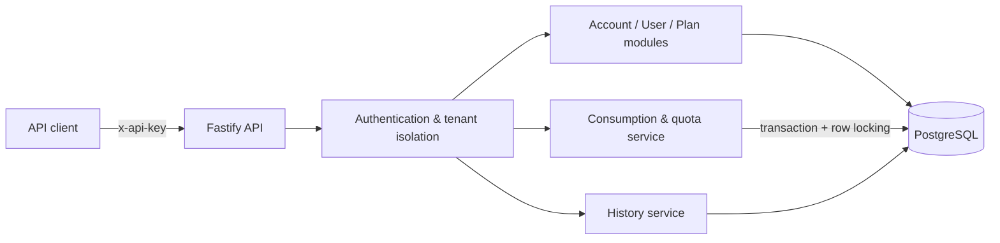

# FTS Usage Metering & Quota Service

> A multi-tenant API service for reliable usage tracking, quota enforcement, and auditable consumption decisions.

[](https://nodejs.org/)
[](https://www.typescriptlang.org/)
[](https://fastify.dev/)
[](https://www.postgresql.org/)
[](https://docs.docker.com/compose/)

## Overview

**FTS Usage Metering & Quota Service** records API usage for multiple accounts and their users. Each consumption request is evaluated against the account's and user's active quotas; the service then returns an accepted or rejected decision, stores an audit record, and prevents a repeated request from consuming units twice.

The implementation is a **TypeScript/Fastify modular monolith** with **PostgreSQL 17**, **Drizzle ORM**, and a Docker Compose deployment.

### Key capabilities

- **Multi-tenant isolation:** accounts authenticate with API keys; protected resources are scoped to the authenticated account.
- **Hierarchical quota checks:** evaluate both account-level and user-level limits.
- **Plan management:** predefined plans, account-specific custom plans, and user plan assignments.
- **Usage rules:** maximum units per request and per UTC calendar month.
- **Idempotent metering:** retrying the same `requestId` and payload returns the original decision without consuming additional units.
- **Conflicting retry detection:** reusing a request ID with different consumption data returns `409 Conflict`.
- **Concurrency safety:** transactional locking serializes competing consumption operations so accepted usage stays within quota.
- **Auditability:** record accepted and rejected requests, with paginated history retrieval.
- **Reproducible deployment:** API startup runs database migrations and seeds predefined plans.
- **Verification:** example client, automated integration/concurrency tests, and a lightweight read-only performance benchmark.

---

## Architecture



The application separates HTTP routes from domain services and database access. A consumption operation evaluates the active account and user plans inside a database transaction and persists its decision atomically.

### Technology stack

| Layer | Technology |
| --- | --- |
| Runtime | Node.js 22 |
| Language | TypeScript |
| HTTP server | Fastify 5 |
| Database | PostgreSQL 17 |
| ORM / migrations | Drizzle ORM / Drizzle Kit |
| Containers | Docker, Docker Compose |
| Testing | Node.js built-in test runner (`node:test`) |

### Repository layout

```text
usage-metering-service/
├── src/
│   ├── app.ts                  # Fastify application and route registration
│   ├── server.ts               # HTTP server entry point
│   ├── db/
│   │   ├── client.ts           # PostgreSQL connection / Drizzle client
│   │   ├── migrate.ts          # Migration runner
│   │   └── seed.ts             # Predefined plan seed
│   ├── modules/                # Accounts, users, plans, consumption, history
│   └── scripts/
│       └── create-account.ts   # Local account / API-key setup utility
├── drizzle/                    # Versioned SQL migrations
├── example-client/
│   └── client.mjs              # End-to-end usage example
├── tests/
│   ├── integration.test.mjs
│   ├── concurrency.test.mjs
│   └── performance.mjs
├── Dockerfile
├── compose.yaml
├── .env.example
└── README.md
```

---

## Quick start with Docker Compose

### Prerequisites

- Docker Engine / Docker Desktop with Docker Compose v2.
- Available ports **3000** (API) and **5433** (PostgreSQL host mapping).
- Node.js 22 and npm **only** if you also want to run the local example client, scripts, or tests.

### 1. Configure the environment

```bash
cp .env.example .env
```

Set the database values in `.env`. The expected variables are:

```dotenv
POSTGRES_USER=fts_user
POSTGRES_PASSWORD=replace_with_a_strong_password
POSTGRES_DB=fts_usage
```

**Important:** the values above are illustrative, not real credentials. Choose a strong password. Never commit `.env` or plaintext API keys.

If you already have an initialized database volume, changing the values in `.env` will **not** automatically change that database's existing username/password; continue using the original credentials or perform an intentional database credential migration.

### 2. Build and start

```bash
docker compose up --build -d
```

On startup, Compose:

1. Starts PostgreSQL and waits for its health check.
2. Starts the API container.
3. Executes committed database migrations.
4. Seeds predefined plans.
5. Starts the Fastify HTTP server.

Database data is persisted in the `postgres_data` named volume. Migrations and predefined-plan seeding are designed to be safe across application restarts.

### 3. Verify the services

```bash
docker compose ps
curl http://127.0.0.1:3000/health
```

Expected response:

```json
{"status":"ok"}
```

Inspect startup logs:

```bash
docker compose logs --tail=100 api
```

A healthy startup includes messages indicating that migrations completed, predefined plans were seeded, and the server started listening.

### 4. Stop without deleting data

```bash
docker compose down
```

**Do not use `docker compose down -v` unless you explicitly intend to delete the PostgreSQL data volume.**

### Docker BuildKit workaround (environment-specific)

On one Windows/WSL Docker Desktop environment, the default builder produced `Segmentation fault` even for `RUN node -v`. A separate `buildx` builder successfully built and exported the project image:

```bash
docker buildx create --name fts-isolated --driver docker-container --bootstrap

docker buildx build \
  --builder fts-isolated \
  --progress=plain \
  -t usage-metering-service-api \
  --load \
  .

docker compose up -d --no-build
```

The builder-creation command only needs to run once per builder name. This workaround is **not** necessary if standard `docker compose up --build -d` works on your machine.

---

## Domain model and quota behavior

### Main database entities

| Entity | Responsibility |
| --- | --- |
| `accounts` | Tenant accounts |
| `users` | Users belonging to an account |
| `api_keys` | Hashed API key records used for authentication |
| `plans` | Predefined or account-specific quota definitions |
| `plan_assignments` | Active and historical plan assignments |
| `request_history` | Auditable accepted/rejected consumption decisions |
| `usage_records` | Accepted consumption used for quota totals |

### Predefined plans

The seed initializes four plans:

| Scope | Plan | Monthly units | Max units/request |
| --- | --- | ---: | ---: |
| Account | Starter | 10,000 | 100 |
| Account | Pro | 100,000 | 1,000 |
| User | Basic | 1,000 | 20 |
| User | Premium | 5,000 | 200 |

Accounts can also define custom plans. Account-owned custom plans must not be assigned across tenant boundaries.

### Consumption decision flow

For an authenticated `POST /consume` request:

1. Identify the account from its API key.
2. Check whether the account already processed that `requestId`.
3. If it did, replay the original decision for an identical payload, or return `409` if the payload differs.
4. Resolve the account-owned user and active plan assignments.
5. Check account and user per-request limits and UTC-month usage limits.
6. Persist the decision in `request_history`; if accepted, also persist usage in `usage_records`.
7. Return the decision and updated usage totals.

The service uses PostgreSQL transactions and row locks to guard competing requests against over-consuming a shared quota. Monthly windows use **UTC calendar months**.

---

## Authentication and security

Protected endpoints require a tenant API key:

```http
x-api-key: YOUR_API_KEY
```

API keys are generated for accounts and stored in hashed form (SHA-256) in the database. Keep the original plaintext key secure: avoid committing it, logging it, or embedding it in example source files.

A local account-creation utility is included at `src/scripts/create-account.ts`. Run it from the project environment with the expected database configuration; check the script's argument/interface requirements before use.

The Compose configuration binds the host-facing API and database ports to `127.0.0.1`, not to every network interface. Authentication and tenant scoping still apply to protected endpoints.

---

## HTTP API

Base URL (local): **`http://127.0.0.1:3000`**

| Method | Route | Purpose | Auth |
| --- | --- | --- | --- |
| `GET` | `/health` | Health check | No |
| `GET` | `/account` | Authenticated account details | Yes |
| `POST` | `/users` | Create a user within the authenticated account | Yes |
| `GET` | `/users/:userId` | Get an account-owned user | Yes |
| `POST` | `/plans` | Create an account-specific custom plan | Yes |
| `PUT` | `/users/:userId/plan` | Assign a valid plan to a user | Yes |
| `POST` | `/consume` | Evaluate and record consumption | Yes |
| `GET` | `/history` | Paginated request history | Yes |

### Example: consume units

```http
POST /consume HTTP/1.1
Content-Type: application/json
x-api-key: YOUR_API_KEY
```

```json
{
  "requestId": "demo-request-001",
  "userId": 1,
  "units": 1
}
```

Example **accepted** response shape (totals are illustrative):

```json
{
  "requestId": "demo-request-001",
  "accountId": 3,
  "userId": 1,
  "units": 1,
  "status": "accepted",
  "rejectionReason": null,
  "blockingLevel": null,
  "accountMonthlyUsed": "41",
  "userMonthlyUsed": "41",
  "replayed": false
}
```

For the same `requestId` and identical payload, `replayed` is `true` and the monthly counters do not increase. If the `requestId` is reused with different units or user information, the API returns **HTTP 409 Conflict**.

Requests beyond a quota are recorded with `status: "rejected"`, a rejection reason (for example, `USER_MONTHLY_LIMIT_EXCEEDED`), and the blocking scope (`account` or `user`).

### Example: history with pagination

```http
GET /history?userId=1&limit=10&offset=0 HTTP/1.1
x-api-key: YOUR_API_KEY
```

The response includes an `items` array with request IDs, unit amounts, decisions, rejection details, and timestamps; pagination metadata includes the total number of matching records.

### Try the API with cURL

The following approach avoids printing the API key to the terminal:

```bash
read -r -s -p "Account API key: " API_KEY; echo

curl -sS http://127.0.0.1:3000/consume \
  -H "Content-Type: application/json" \
  -H "x-api-key: $API_KEY" \
  -d '{"requestId":"manual-demo-001","userId":1,"units":1}'

unset API_KEY
```

Use a **new** `requestId` for each distinct consumption attempt and an existing user ID belonging to the API key's account.

---

## Example client

The standalone client at `example-client/client.mjs` demonstrates a complete usage flow with no extra npm packages:

1. Submit a consumption request with a fresh UUID.
2. Retry the same request and verify `replayed: true` and unchanged counters.
3. Fetch history and confirm the request was recorded.

Run it against a running API:

```bash
read -r -s -p "Account API key: " API_KEY; echo
API_KEY="$API_KEY" EXAMPLE_USER_ID=1 node example-client/client.mjs
unset API_KEY
```

`EXAMPLE_USER_ID` must reference a user in the authenticated account. Each run normally consumes **one unit** if the plan permits it.

---

## Development

With Node.js 22 installed:

```bash
npm ci
```

Start only the database container (the development API uses the same port as the containerized API):

```bash
docker compose up -d db
```

Apply migrations and seed plans against the local database:

```bash
npx tsx src/db/migrate.ts
npx tsx src/db/seed.ts
```

Run the development server:

```bash
npm run dev
```

Validate and compile:

```bash
npm run typecheck
npm run build
```

The local database connection defaults to `127.0.0.1:5433` unless overridden by `DB_HOST` / `DB_PORT`; the API defaults to `127.0.0.1:3000` unless configured otherwise. Ensure your `.env` contains the same database credentials used by the Compose service.

**Port conflict:** do not run `npm run dev` alongside the Dockerized API on the same host port 3000.

---

## Testing

> **Prerequisites:** the API and database are running; you have a valid account API key and an existing user belonging to that account. Consumption tests **write real usage records**, so use a test account with sufficient remaining quota.

### Automated integration tests

```bash
read -r -s -p "Test account API key: " API_KEY; echo
API_KEY="$API_KEY" EXAMPLE_USER_ID=1 node --test tests/integration.test.mjs
unset API_KEY
```

Covers:

- `GET /health`
- Unauthorized account access (`401`)
- Accepted consumption
- Idempotent retry without double charging
- Conflicting retry (`409`)
- History persistence

### Automated concurrency tests

```bash
read -r -s -p "Test account API key: " API_KEY; echo
API_KEY="$API_KEY" EXAMPLE_USER_ID=1 node --test tests/concurrency.test.mjs
unset API_KEY
```

Covers:

- **10 simultaneous distinct requests:** all accepted when sufficient quota remains, and usage totals progress without duplicates.
- **5 simultaneous identical retries:** exactly one original consumption and four replays.

**Quota note:** under the successful test scenario, the integration test consumes one unit and the concurrency suite consumes eleven additional units. Tests may fail if quotas are exhausted or other clients concurrently consume usage. The tests do not automatically reset the database.

### Lightweight performance benchmark

```bash
read -r -s -p "Test account API key: " API_KEY; echo
API_KEY="$API_KEY" EXAMPLE_USER_ID=1 node tests/performance.mjs
unset API_KEY
```

The benchmark sends **100 requests per endpoint** at **concurrency 10** against the read-only `/health` and `/history` endpoints. It reports successful/failed requests, average and p95 latency, and throughput. It does **not** exercise `/consume` or modify usage totals.

### Verified results — October 19, 2026

**Automated functional tests**

| Suite | Passed | Failed |
| --- | ---: | ---: |
| Integration | 3 | 0 |
| Concurrency | 2 | 0 |
| **Total** | **5** | **0** |

**Local performance benchmark (API inside Docker)**

| Metric | Health | History |
| --- | ---: | ---: |
| Requests | 100 | 100 |
| Successful | 100 | 100 |
| Failed | 0 | 0 |
| Average latency | 101.32 ms | 411.26 ms |
| P95 latency | 235.20 ms | 1,000.26 ms |
| Throughput | 83.17 req/s | 23.28 req/s |

These are **local measurements**, not production service-level guarantees. History queries were slower than health checks in this run; further analysis may investigate query plans, indexes, database sizing, and environment overhead.

---

## Operational notes and limitations

- **Data persistence:** PostgreSQL is backed by a Docker named volume. Preserve and back up the database independently of source control.
- **Secrets:** do not commit `.env`, API keys, or exported database credentials. Provide `.env.example` with placeholder values only.
- **Re-runnable setup:** the migration runner uses the migrations recorded by Drizzle, and the predefined-plan seeding is designed to avoid duplicating plans.
- **Tenant safety:** use an account-specific key for all protected calls and verify user IDs belong to the current account.
- **Monthly boundaries:** monthly quotas follow UTC calendar months.
- **Build compatibility:** an isolated BuildKit builder was required on the development Windows/WSL system because the default builder segfaulted; this is an environment-specific workaround.
- **Verification boundary:** the service was verified against an **existing initialized database** with Compose, with five automated tests and the benchmark above. A fully fresh-database deployment and a direct `docker compose up --build` run were **not yet independently verified** at the time these results were recorded.
- **Potential follow-ups:** expand tenant-isolation tests, boundary tests, failure-path coverage, load testing under varying quotas, and history query optimization.

---

## License

No license is declared in this repository. All rights are reserved unless a license is added by the project owner.
